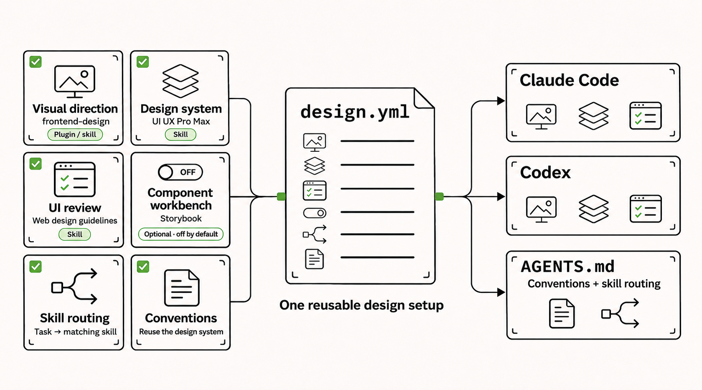

# loadouts

> [!NOTE]
> The initial version of this README was written by an AI agent.

**Tell Claude Code or Codex what you want to work on. Your agent can use loadouts to find, equip and share the tools for that work.**

A loadout is like a saved equipment set in a game. A UI review skill, a design plugin and a Storybook MCP server are individual pieces of gear. A design loadout puts them together with your team's conventions and tells the agent when to use each piece. Your project can select several loadouts and switch individual choices as the work changes.

## Start in your project

Open the repository in Claude Code, Codex CLI or Codex Desktop and ask:

> Help me set up loadouts for this project. Install the CLI from npm (`@katisfaktion/loadouts`) if needed, then read its bundled guides with `loadouts agents`. Look at our stack and the shared catalog. Show me what you'd reuse and what you'd add before installing any tools.

If the repository already has a setup, the request is shorter:

> Restore this project's loadouts and check that my agent has the tools the team selected.

The agent runs the CLI. You decide which tools and conventions belong in the project. To make the bundled guides discoverable in future sessions, ask the agent to configure loadouts for the agents you use. That adds a short reference to their user-level instructions. You can continue opening each agent normally.

The npm package provides a native binary for Linux (glibc) and macOS on x64 or arm64, and Windows on x64. Installing skills requires Node.js 22.20.0 or later with `npx`. Standalone binaries are also available. [GitHub Releases](https://github.com/katisfaktion/loadouts/releases)

## From a local experiment to a shared loadout

Suppose you're adding browser tests. You can take the setup through a project one request at a time.

| When | Ask your agent |
| --- | --- |
| Planning the feature | “Does our current setup cover browser testing? Check the catalog before drafting anything.” |
| Choosing tools for the branch | “Use the Playwright option for this feature. Show me what changed for Claude Code and Codex.” |
| Something is missing | “Codex can't see the testing skill after checkout. Find out why before changing the setup.” |
| The setup has proved useful | “We used this on the checkout regression. Compare our testing loadout with the catalog and show me the proposed contribution.” |

Exploration can produce a small project-local YAML draft. Once you select it, the project manifest and lockfiles let teammates restore the setup. When you decide to share it, the agent can preview a catalog contribution and open a pull request with your approval. The author's [working catalog](https://github.com/katisfaktion/agent-loadouts) has examples for testing, design and other concerns.

## How it fits together

A **loadout** defines reusable capabilities and choices. A **catalog** stores loadouts that multiple projects can use. A **project manifest** selects the ones your team wants, and the locks record what was applied. Claude Code and Codex read their native project settings and instructions. [Concepts, file formats and compatibility](docs/reference.md)

## Contributing to loadouts

This repository has its own agent setup for Bun, Optique and GitHub contributions. Ask your agent to install the project dependencies with Bun 1.4.4 and restore the repository's loadouts before working on the CLI. User-visible changes include a Changeset. [Release workflow](docs/reference.md#releasing-the-cli)
